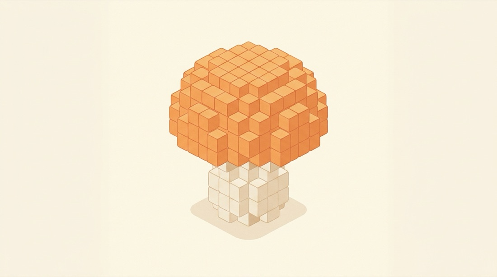

# ボクセル工房

文字や画像を、積み木のような小さな立方体 (ボクセル) を積んだ立体に変える、ブラウザで動く道具です。



- 使い方の説明: [guide.html](guide.html) (元原稿は [docs/public/index.md](docs/public/index.md))
- 本体: [index.html](index.html) の 1 ファイルだけです。組み立ての作業はいりません。

## 手元で動かす

```bash
python3 -m http.server 8766
```

ブラウザで `http://localhost:8766/` を開きます。書体と立体の表示の部品をインターネットから読み込むので、接続が必要です。

## 中身

| パス | 役割 |
| --- | --- |
| `index.html` | 本体 (画面・処理のすべて) |
| `guide.html` | 使い方の説明ページ。`tools/build_guide.py` が `docs/public/index.html` から作る |
| `docs/public/` | 説明ページの元原稿と挿絵 |
| `tools/build_guide.py` | 説明ページを単体で開ける形に組み立てる |
| `.github/workflows/deploy.yml` | `main` に送るたびに、公開に必要なファイルだけを `gh-pages` ブランチに置く |

## 挿絵について

説明ページの挿絵 2 枚 (`docs/public/images/`) は AI (Gemini) が作りました。図は Claude が描きました。

## ライセンス

[MIT ライセンス](LICENSE) です。著作権の表示を残せば、自由に使う・直す・配ることができます。無保証です。

画面を開いたときに読み込む three.js と Google Fonts の書体は、このリポジトリには含まれていません。それぞれのライセンスに従います。
