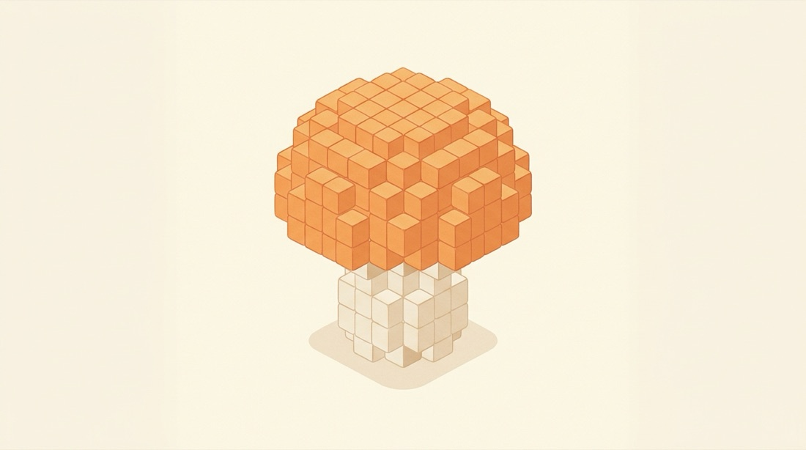
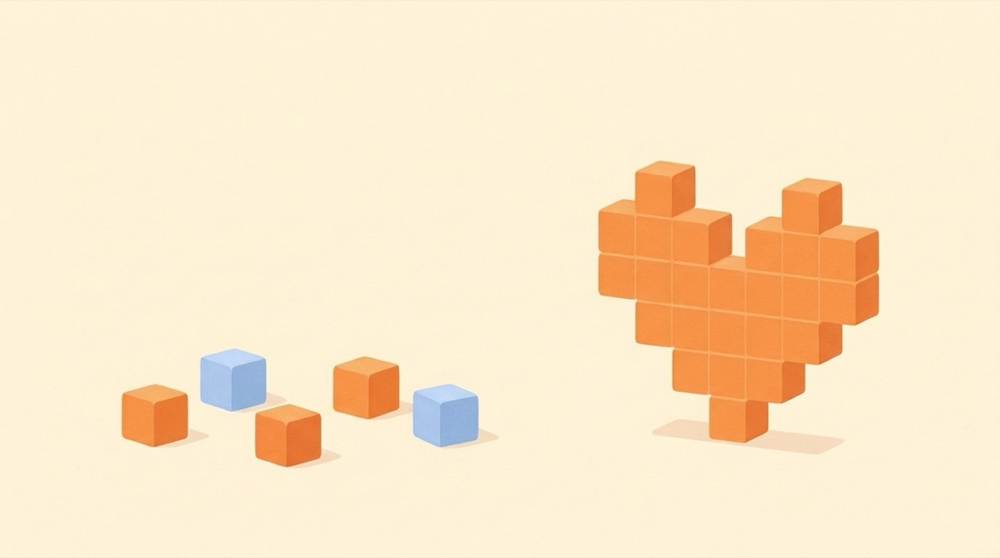

# ボクセル工房

## ひとことで言うと

文字や画像を、積み木のような小さな立方体を積んだ立体に変える道具です。山や湖のある小さな風景を、自動で作ることもできます。
できた立体は、画面の上でぐるぐる回して眺められます。

## こんな人・こんな場面に

- 自分の名前や好きな言葉を、ブロックの立体にして眺めたいとき。
- ドット絵やイラストを立体にしたら、どう見えるか試したいとき。
- ブロックで作るゲームの建物の下書きがほしいとき。
- ブロックでできた小さな山や島を、いろいろな向きから眺めたいとき。

## できること

- 文字を打つと、その文字が立体になります。書体は 7 種類から選べます。手書きのような「へたうま」の書体もあります。
- 文字の色を選べます。2 色がなめらかに変わる色づけもできます。
- 画像を選ぶと、その絵が立体になります。PNG・JPG・GIF が使えます。
- 画像の一部だけを選んで、そこだけを立体にできます。
- 写真を、色の数をしぼったイラスト風に変えてから立体にできます。
- 画像の背景を自動で消せます。下絵をクリックして、いらない部分を消したり戻したりもできます。
- 「風景を作る」を選ぶと、山・水辺・木のある小さな風景がブロックでできます。
- 地形は「山と湖」「島」「なだらかな丘」の 3 つから選べます。季節は夏・秋・冬から選べます。
- 「別の風景にする」を押すたびに、ちがう風景になります。
- 風景には 1〜9999 の番号がつきます。同じ番号と同じ設定なら、いつでも同じ風景になります。
- 山の高さ、水の量、木の量を、つまみで変えられます。水の量は、全体の広さのうち水になる割合です。木の量は、草の生えた土地のうち木におおわれる割合です。
- 風景の番号のしくみは、[Zenn の記事](https://zenn.dev/fuyu/articles/b04080091c56e4)にくわしく書きました。
- 文字と画像の立体は、形を「板」「ふくらみ」「明るさで高さ」の 3 つから選べます。
- ブロックの細かさ (横に 8〜128 個) と厚み (1〜32 個) を変えられます。
- できた立体を、回す・近づける・動かすことができます。
- ブロックの位置と色の一覧を、文字のデータとしてコピーできます。
- マインクラフト (Java 版) に置くためのファイルを保存できます (試験中)。手順は「[マインクラフトに置く](https://fu-yu.github.io/voxel-maker/minecraft.html)」のページにあります。

## しくみ (ざっくり)

方眼紙の上に絵を置くところを思い浮かべてください。
絵がかかっているマスにだけ、その場所の色のブロックを置きます。
そのブロックを奥に向かって何個か重ねると、立体になります。

重ね方は 3 つあります。

| 形 | 重ね方 |
| --- | --- |
| 板 | どのマスも同じ数だけ重ねます。クッキーの型で抜いたような形です。 |
| ふくらみ | 絵のまん中ほど多く、ふちほど少なく重ねます。丸みのある形です。 |
| 明るさで高さ | 明るい色のマスほど多く重ねます。でこぼこの浮き彫りのような形です。 |

## 使ってみる

ボクセル工房は、ブラウザで [https://fu-yu.github.io/voxel-maker/](https://fu-yu.github.io/voxel-maker/) を開くだけで使えます。入れるものはありません。

1. 画面の上で「文字から」「画像から」「風景を作る」のどれかを選びます。
2. 文字を打つか、画像を選びます。お試しなら「見本のドット絵」を押します。
3. 「形」で、板・ふくらみ・明るさで高さのどれかを選びます。
4. 「横のマス数」と「厚み」のつまみを動かして、細かさと奥行きを決めます。
5. 立体をドラッグして、好きな向きから眺めます。
6. データがほしいときは「座標データをコピー」を押します。

風景を作るときは、「風景を作る」を選びます。「別の風景にする」を押して、気に入るものを探します。風景では 3 と「厚み」は使いません。

## できないこと・注意

- 立体を 3D のファイルとして保存する機能はありません。できるのは、位置と色の一覧のコピーと、マインクラフト用のファイルの保存 (試験中) です。
- コピーした一覧を、ゲームや 3D のツール、サービスでそのまま開くことはできません。それぞれの形式に直す作業が別に必要です。
- マインクラフト用のファイルは、パソコンの Java 版 1.21 以降が対象です。スマホやゲーム機の版では使えません。
- マインクラフトでは、色を近い色のブロックに置きかえます。画面とまったく同じ色にはなりません。
- 文字の書体と立体の表示に、インターネットから読み込む部品を使っています。つながっていないと正しく表示されません。
- 選んだ画像は、お使いのブラウザの中だけで処理されます。外に送る処理は入っていません。
- 写真は、背景がごちゃごちゃしていると形がきれいに出ません。背景が透明な画像がいちばんきれいに出ます。
- 風景は、番号をもとに自動で作られます。山や木の場所を、自分で 1 つずつ決めることはできません。
- 風景に置かれるのは、地面・水・木だけです。家や道はありません。
- 写真から、地面に山や木が立つ風景を作ることはできません。写真は「明るさで高さ」で、でこぼこの板にできます。
- マスの数を増やすとブロックが数万個 (風景では数十万個) になり、動きが重くなることがあります。

## 更新履歴

- 2026-11-14: マインクラフト (Java 版) 用のファイルを保存する機能を、試験として入れました。
- 2026-11-13: 山・水辺・木のある風景を、自動で作れるようになりました。
- 2026-11-11: 手書きのような「へたうま」の書体を 2 つ選べるようになりました。
- 2026-11-11: だれでもブラウザで開けるようになりました。
- 2026-11-10: この説明ページを作りました。

## ことばの説明

- **ボクセル**: 立体を作る、小さな立方体のブロックのこと。画面の点 (ピクセル) の立体版です。
- **ドット絵**: 四角い点を並べて描いた絵のこと。
- **座標データ**: ブロック 1 個ずつの位置 (横・高さ・奥行き) と色を書き並べた一覧のこと。

---

このページの挿絵は AI (Gemini) が作りました。図は Claude が描きました。
