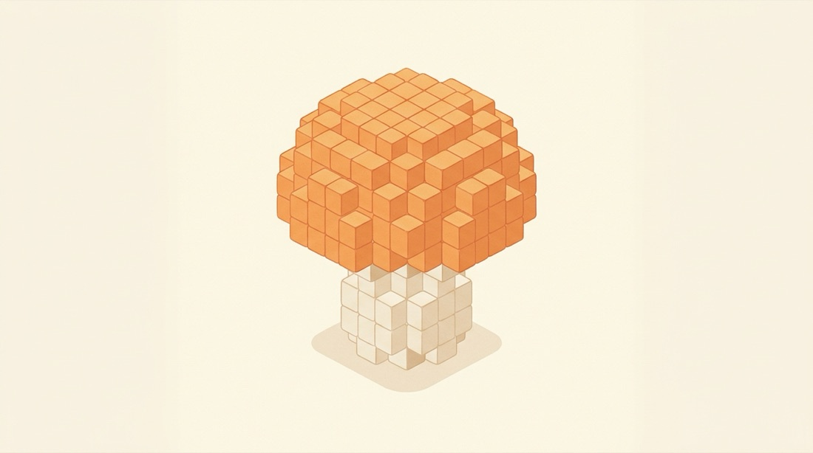
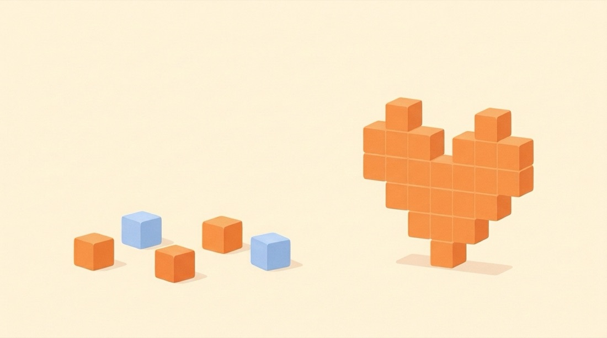

# ボクセル工房

## ひとことで言うと

文字や画像を、積み木のような小さな立方体を積んだ立体に変える道具です。山や湖のある小さな風景を、自動で作ることもできます。
できた立体は、画面の上でぐるぐる回して眺められます。

## こんな人・こんな場面に

- 自分の名前や好きな言葉を、ブロックの立体にして眺めたいとき。
- ドット絵やイラストを立体にしたら、どう見えるか試したいとき。
- ブロックで作るゲームの建物の下書きがほしいとき。
- ブロックでできた小さな山や島を、いろいろな向きから眺めたいとき。

## できること

- 文字を打つと、その文字が立体になります。書体は7種類から選べます。手書きのような「へたうま」の書体もあります。
- 文字の色を選べます。2色がなめらかに変わる色づけもできます。
- 画像を選ぶと、その絵が立体になります。PNG・JPG・GIFが使えます。
- 画像の一部だけを選んで、そこだけを立体にできます。
- 写真を、色の数をしぼったイラスト風に変えてから立体にできます。
- 画像の背景を自動で消せます。下絵をクリックして、いらない部分を消したり戻したりもできます。
- 「風景を作る」を選ぶと、山・水辺・木のある小さな風景がブロックでできます。
- 地形は「山と湖」「島」「なだらかな丘」の3つから選べます。季節は春・夏・秋・冬から選べます。春は、丸い木の3本に1本くらいがサクラになります。
- 木の形は「小さな緑の木」と「マインクラフトの木」から選べます。「マインクラフトの木」は、マインクラフト (26.3) の木と同じ形と大きさです (オーク・シラカバ・トウヒ・マツ。春はサクラもまじり、秋はポプラ)。
- 「山の上から水を流す」をオンにすると、マインクラフト用に保存したとき、高い山のいくつか (最大3か所) のてっぺんに水を置きます。ゲームの中で、水が山を下って流れます。流れた水が風景の外にこぼれない山だけを選びます。流れた先が山の途中のくぼみなら、くぼみを水で満たして池にします。冬の風景では置きません。画面の立体にも、ゲームの中で流れ終わったあとの水 (滝や池) を、湖と同じ色で表示します。
- 「別の風景にする」を押すたびに、ちがう風景になります。
- 風景には1〜9999の番号がつきます。同じ番号と同じ設定なら、いつでも同じ風景になります。
- 山の高さ、水の量、木の量を、つまみで変えられます。水の量は、全体の広さのうち水になる割合です。木の量は、草の生えた土地のうち木におおわれる割合です。
- 風景の番号のしくみは、[Zennの記事](https://zenn.dev/fuyu/articles/b04080091c56e4)にくわしく書きました。
- 文字と画像の立体は、形を「板」「ふくらみ」「明るさで高さ」の3つから選べます。
- ブロックの細かさ (横に8〜128個) と厚み (1〜32個) を変えられます。
- できた立体を、回す・近づける・動かすことができます。
- ブロックの位置と色の一覧を、文字のデータとしてコピーできます。
- マインクラフト (Java版) に置くためのファイルを保存できます (試験中)。手順は「[マインクラフトに置く](https://fu-yu.github.io/voxel-maker/minecraft.html)」のページにあります。置いてみた様子は「[マインクラフトで試してみた](https://fu-yu.github.io/voxel-maker/tried/)」に、写真つきでまとめています。

## しくみ (ざっくり)

方眼紙の上に絵を置くところを思い浮かべてください。
絵がかかっているマスにだけ、その場所の色のブロックを置きます。
そのブロックを奥に向かって何個か重ねると、立体になります。

重ね方は3つあります。

| 形 | 重ね方 |
| --- | --- |
| 板 | どのマスも同じ数だけ重ねます。クッキーの型で抜いたような形です。 |
| ふくらみ | 絵のまん中ほど多く、ふちほど少なく重ねます。丸みのある形です。 |
| 明るさで高さ | 明るい色のマスほど多く重ねます。でこぼこの浮き彫りのような形です。 |

## 使ってみる

ボクセル工房は、ブラウザで [https://fu-yu.github.io/voxel-maker/](https://fu-yu.github.io/voxel-maker/) を開くだけで使えます。入れるものはありません。

1. 画面の上で「文字から」「画像から」「風景を作る」のどれかを選びます。
2. 文字を打つか、画像を選びます。お試しなら「見本のドット絵」を押します。
3. 「形」で、板・ふくらみ・明るさで高さのどれかを選びます。
4. 「横のマス数」と「厚み」のつまみを動かして、細かさと奥行きを決めます。
5. 立体をドラッグして、好きな向きから眺めます。
6. データがほしいときは「座標データをコピー」を押します。

風景を作るときは、「風景を作る」を選びます。「別の風景にする」を押して、気に入るものを探します。風景では3と「厚み」は使いません。

## できないこと・注意

- 立体を3Dのファイルとして保存する機能はありません。できるのは、位置と色の一覧のコピーと、マインクラフト用のファイルの保存 (試験中) です。
- コピーした一覧を、ゲームや3Dのツール、サービスでそのまま開くことはできません。それぞれの形式に直す作業が別に必要です。
- マインクラフト用のファイルは、パソコンのJava版1.21以降が対象です。スマホやゲーム機の版では使えません。
- マインクラフトでは、色を近い色のブロックに置きかえます。画面とまったく同じ色にはなりません。
- 文字の書体と立体の表示に、インターネットから読み込む部品を使っています。つながっていないと正しく表示されません。
- 選んだ画像は、お使いのブラウザの中だけで処理されます。外に送る処理は入っていません。
- 写真は、背景がごちゃごちゃしていると形がきれいに出ません。背景が透明な画像がいちばんきれいに出ます。
- 風景は、番号をもとに自動で作られます。山や木の場所を、自分で1つずつ決めることはできません。
- 風景に置かれるのは、地面・水・木だけです。家や道はありません。
- 写真から、地面に山や木が立つ風景を作ることはできません。写真は「明るさで高さ」で、でこぼこの板にできます。
- マスの数を増やすとブロックが数万個 (風景では数十万個) になり、動きが重くなることがあります。

## 更新履歴

- 2026-11-17: 季節に「春」が加わり、サクラの木が咲くようになりました (記録: [6. 春のサクラを置いてみた](https://fu-yu.github.io/voxel-maker/tried/spring.html))。
- 2026-11-17: 風景の木を、マインクラフトの木と同じ形と大きさにも切りかえられるようになりました (記録: [7. ゲームと同じ形の木を置いてみた](https://fu-yu.github.io/voxel-maker/tried/trees.html))。
- 2026-11-14: マインクラフト (Java版) 用のファイルを保存する機能を、試験として入れました。
- 2026-11-13: 山・水辺・木のある風景を、自動で作れるようになりました。
- 2026-11-11: 手書きのような「へたうま」の書体を2つ選べるようになりました。
- 2026-11-11: だれでもブラウザで開けるようになりました。
- 2026-11-10: この説明ページを作りました。

## ことばの説明

- **ボクセル**: 立体を作る、小さな立方体のブロックのこと。画面の点 (ピクセル) の立体版です。
- **ドット絵**: 四角い点を並べて描いた絵のこと。
- **座標データ**: ブロック1個ずつの位置 (横・高さ・奥行き) と色を書き並べた一覧のこと。

## アクセス解析とクッキーについて

このサイトでは、利用状況を把握して改善に役立てるため、Google社の「Googleアナリティクス」を使っています。

- データの収集には **クッキー (Cookie)** を使いますが、個人を特定する情報 (名前やメールアドレスなど) は集めません。
- 収集されたデータの扱いについては、Googleのページ「[Googleのサービスを使用するサイトやアプリから収集した情報のGoogleによる使用](https://www.google.com/intl/ja/policies/privacy/partners/)」をご覧ください。
- クッキーを使いたくない場合は、お使いのブラウザの設定でクッキーを無効にできます。

---

このページの挿絵はAI (Gemini) が作りました。図はClaudeが描きました。
