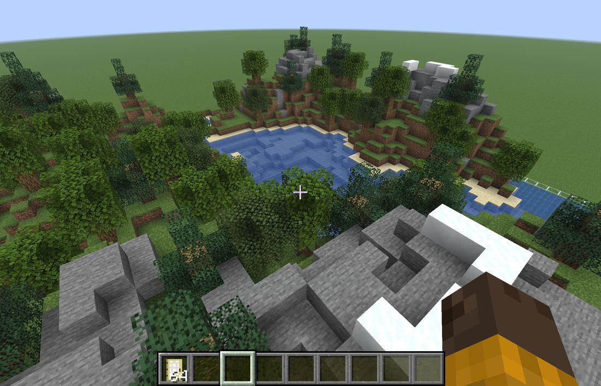
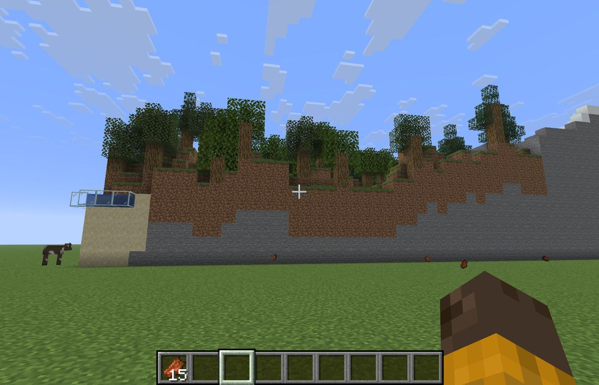
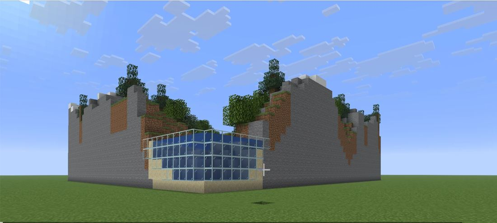
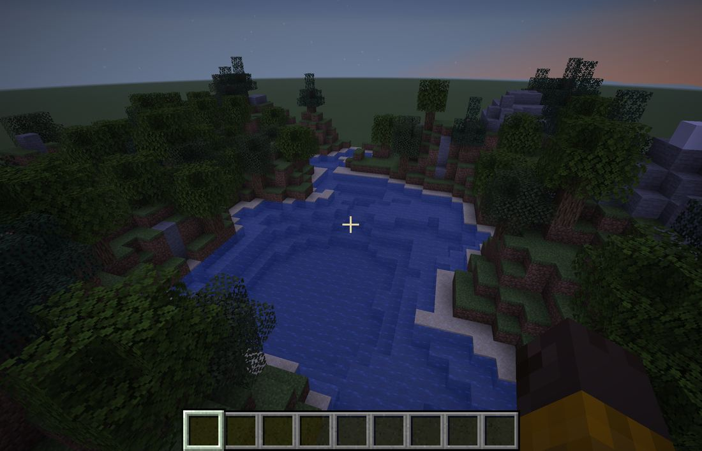
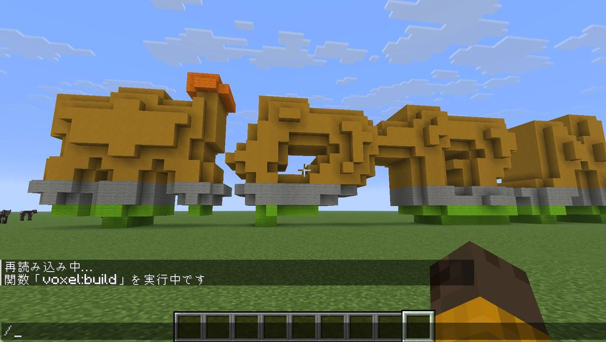

# マインクラフトで試してみた

## ひとことで言うと

ボクセル工房で作った立体を、本物のマインクラフトに置いて確かめた記録です。
うまくいったことも、見つけた問題も、そのまま書いています。

## 試した環境

- マインクラフト Java 版 26.3 の、ひとりで遊ぶモードです。
- 平らな地面だけのワールド (スーパーフラット) に置きました。
- 試した日は 2026-11-14 です。
- 置き方は「[マインクラフトに置く](https://fu-yu.github.io/voxel-maker/minecraft.html)」のページのとおりです。

## 1. 風景を置いてみた

地形は「山と湖」、季節は「夏」です。

### 上から見る

いちばん上の写真です。湖、岸の砂、草の斜面、林、雪ののった石の山が、ボクセル工房の画面と同じ並びで置かれました。
水は湖の形におさまり、木の葉も残りました。

### 横から見る

風景は、地面の上に台のようにのります。地面に立って見ると、まわりが土と石の高い壁になりました。
歩いては登れないので、空を飛んで中に入りました。

### 角から見る

水がふちにある所には、ガラスが立ちます。水は外に流れ出しませんでした。
近くで見ると、ガラスの枠の線が見えます。

### 夕方に見る

夕方や夜は、全体が暗く写ります。色を見比べたいときは、昼にします。
チャットの欄に `/time set day` と打つと、昼になります。

## 2. 文字を置いてみた

- 文字は、裏返しにならず、左から読める向きに置かれました。
- 色に問題がありました。上の橙から下の黄緑へ変わる色づけの途中に、灰色の帯が入りました。
- 同じ日に、色の選び方を直しました。直したあとの写真は、まだありません。

## 見つけて直したこと

| 見つけたこと | 直し方 |
| --- | --- |
| 木の幹の下の草が、時間がたつと土に変わった | はじめから土を置くようにした |
| 文字の色分けに、灰色がまじった | 近い色の選び方を、人の目の感じ方に近い方法に変えた |

## 試すときのこつ

- 空を飛ぶと、上から全体を見られます。クリエイティブモードで、スペースのキーを 2 回すばやく押します。
- 写真は、マインクラフトのスクリーンショットの機能で撮りました。ノート型の Mac では、はじめのキー (F2) がそのままでは効きませんでした。マインクラフトの「キー割り当て」で、別のキーに変えると撮れました。

## これから試すこと

- 歩きやすい設定 (なだらかな丘、横 128 マス、山を低め) で置いて、歩いてみる。
- 風景を少し下にずらして置き、まわりの壁を低くする。
- 色の選び方を直したあとの文字を置く。
- 秋と冬の風景、島と丘の地形を置く。

---

このページの写真は、マインクラフトの画面を撮ったものです。
ボクセル工房は、Minecraft の公式の製品ではありません。Mojang や Microsoft とは関係ありません。
