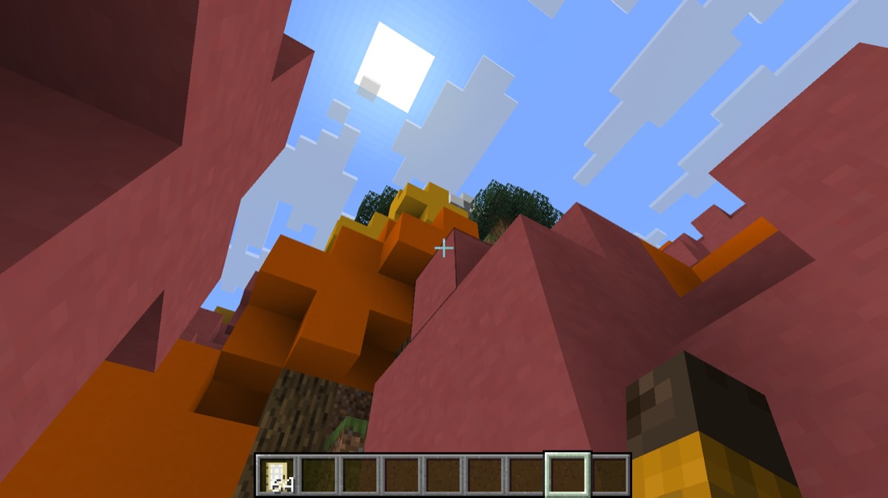
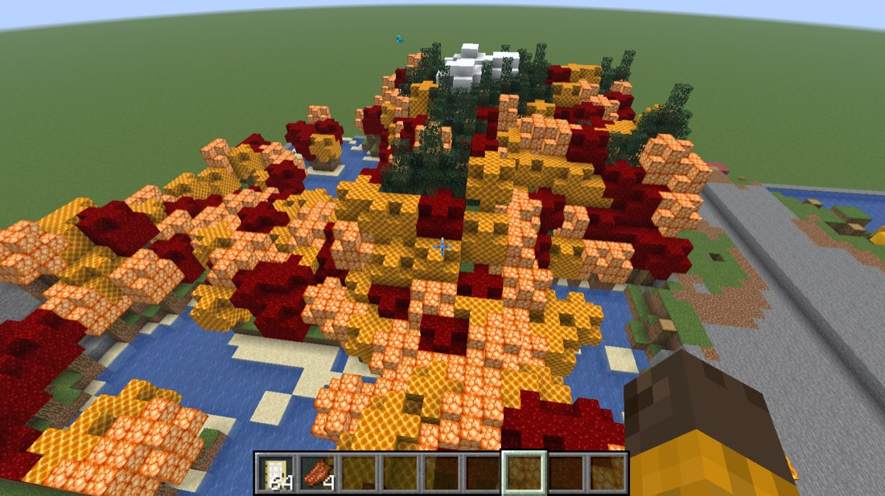
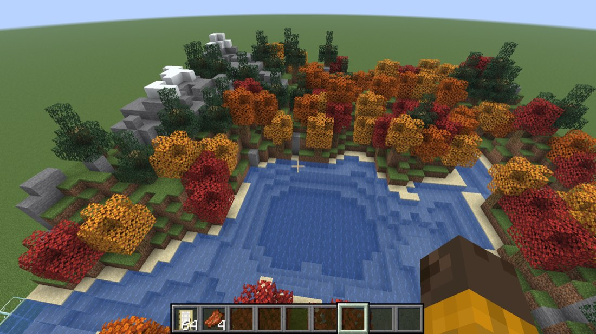
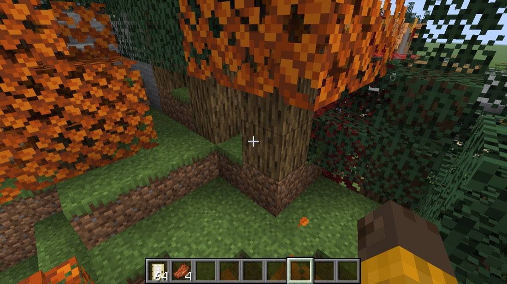

# 5. 秋の風景を置いてみた

[マインクラフトで試してみた](https://fu-yu.github.io/voxel-maker/tried/) の 5 つ目の記録です。
2026-11-15 に「山と湖・秋」の風景を置き、秋の木の葉がどう見えるかを確かめました。葉らしく見えるように、2 回直しました。

## 最初に置いたとき (石の山のように見えた葉)

秋の丸い木の葉は、ピンクのテラコッタ、オレンジと黄色のコンクリートで置かれていました。どれも表面がつるっとしていて、向こうが透けないので、葉というより石の山のように見えました。
このときは、マインクラフトには赤・オレンジ・黄色の葉のブロックがないと考えて、色の近い別のブロックで代わりにしていました。

## 1 回目の直し (模様のあるブロック)

表面に模様のあるブロック (シュルームライト、ネザーウォートブロック、ハニカムブロック) に替えました。つるっとした見た目ではなくなり、ハニカムブロックは六角形の模様がはっきり見えました。ただ、どれも葉のブロックではないので、向こうは透けません。

## 2 回目の直し (ポプラの葉)

調べ直したところ、2026-09-15 に出たマインクラフト Java 版 26.3 で、赤・オレンジ・黄色の「ポプラの葉」のブロックが加わっていたことがわかりました。前に「葉のブロックはない」と考えたのは、知っていたことが古かったための誤りでした。
そこで、秋の木の葉を、この 3 色のポプラの葉に替えました。上から見ると、葉らしく透けて見え、針葉樹の緑や草の色ともなじみました。

近くで見ると、葉のすきまから向こうが透けて見えます。幹は、オークの丸太のままです。

## 気をつけること

- ポプラの葉は 26.3 で加わったブロックなので、秋の風景は 26.3 以降のマインクラフトで使ってください。それより前の版で置いたときの動きは、確かめていません。
- 長い時間がたっても葉が消えずに残るかは、まだ確かめていません。

---

- 前: [4. 少しずつ壊してみた](https://fu-yu.github.io/voxel-maker/tried/break.html)
- [試してみた一覧へ戻る](https://fu-yu.github.io/voxel-maker/tried/)
