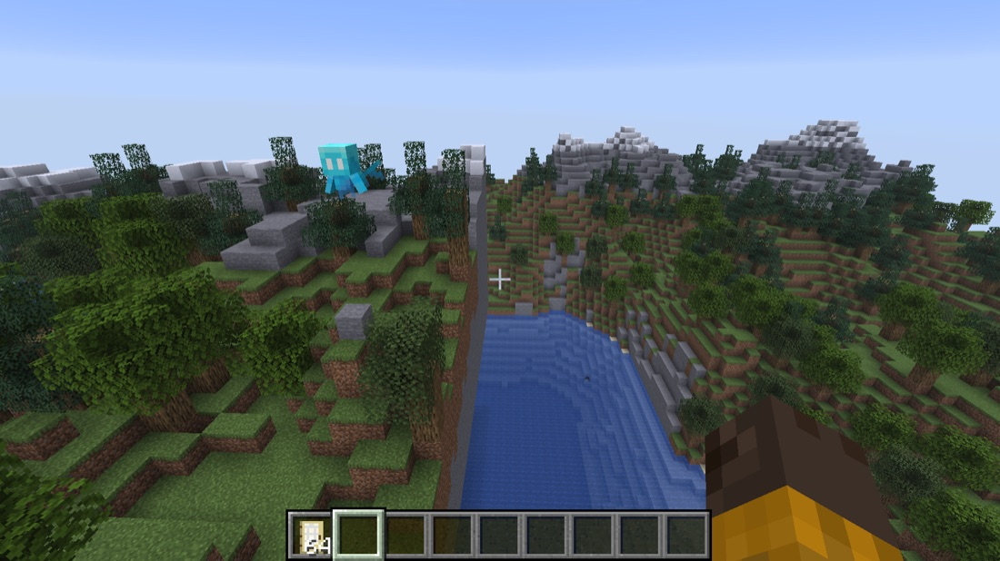
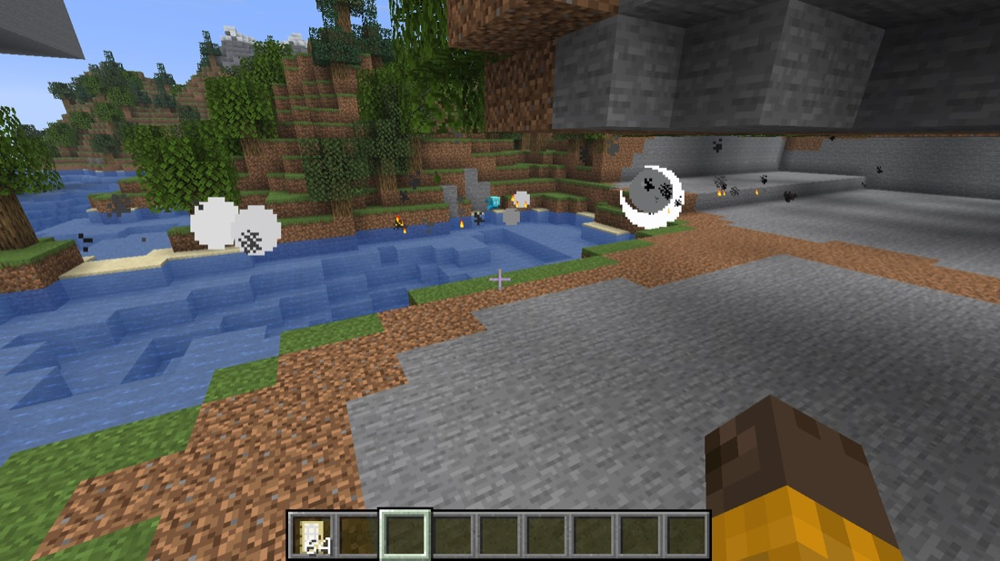
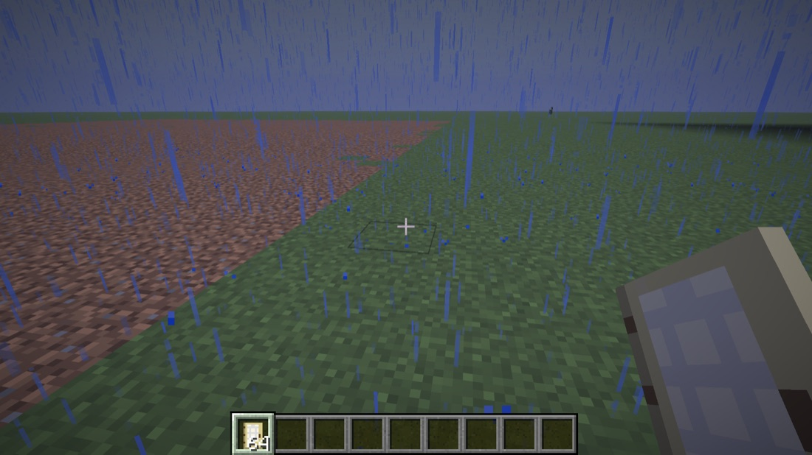

# 4. 少しずつ壊してみた (`voxel:break_slow`)

[マインクラフトで試してみた](https://fu-yu.github.io/voxel-maker/tried/index.html) の 4 つ目の記録です。
置いた大きな風景 (横 128 マス・山の高さ 40 マス、約 32 万ブロック) を、`/function voxel:break_slow` で上の段から少しずつ壊して消しました。

## 最初に試したとき (動かずに固まった妖精)

最初に `/function voxel:break_slow` を打ったときは、「壊す係が壊しはじめます」と出たあと、妖精が建物の前で動かず、ブロックも消えませんでした。
ゲームの記録を調べたところ、爆発の音を鳴らす命令の書き方に誤り (`block` を `blocks` と書いていた) があり、壊す段階のファイルが読み込まれていませんでした。また、ワールドの難易度がピースフルだったため、ヴェックスではなくアレイが出ていました。

## 直したあと (爆発しながら削る)

音の指定を直してやり直したところ、壊す係が飛び回りながら、白い爆発の粒と黒い煙と炎を出して、上の段から順番にブロックを消していきました。水はまわりの枠より先に消えるため、外へあふれ出しませんでした。途中で `/function voxel:break_stop` を打って止める動きも確かめました。

また、チャット欄で `/function voxel:b` と打ったときに、内部用の段階ファイル (`b0`〜`b1005`) が候補に並んで `voxel:break_slow` が選びにくかったため、内部用のファイルを `voxel:slow/` の下に移しました。

## 最後まで消えたあと

「すべて壊しました」と出て、約 32 万ブロックの風景がすべて消え、平らな地面に戻りました。
建物がのっていた場所だけ、地面の草ブロックに光が当たらず茶色い土に変わっており、四角い跡になっていました。マインクラフトの自然な仕組みによるもので、このまま時間がたつと、まわりの緑の草から少しずつ緑に戻ります。

---

- 前: [3. 少しずつ置いてみた](https://fu-yu.github.io/voxel-maker/tried/slow.html)
- [試してみた一覧へ戻る](https://fu-yu.github.io/voxel-maker/tried/index.html)
