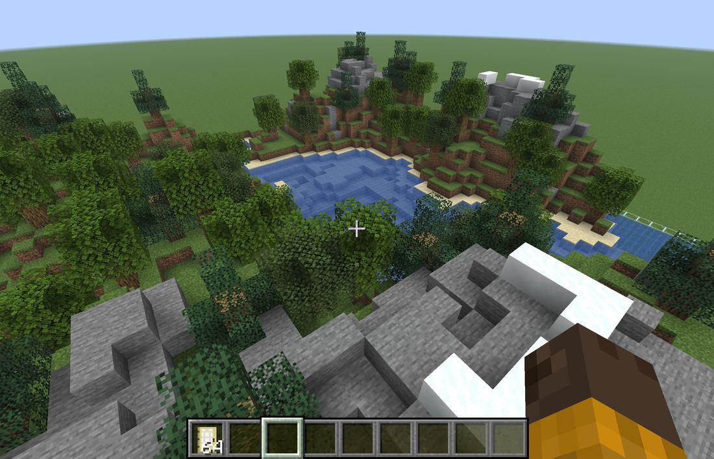
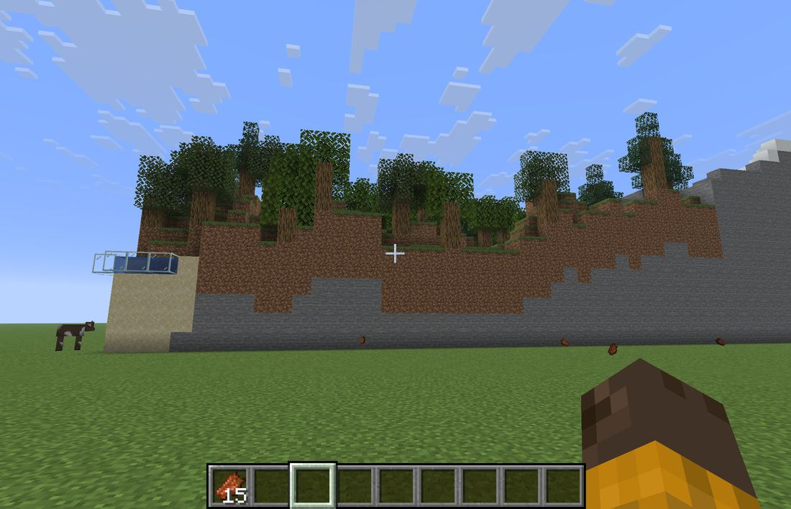
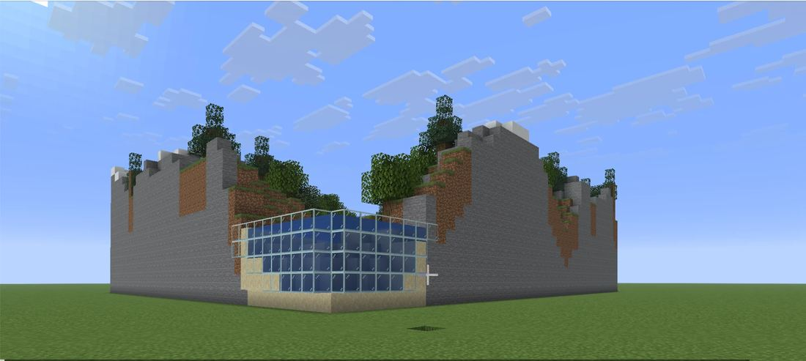
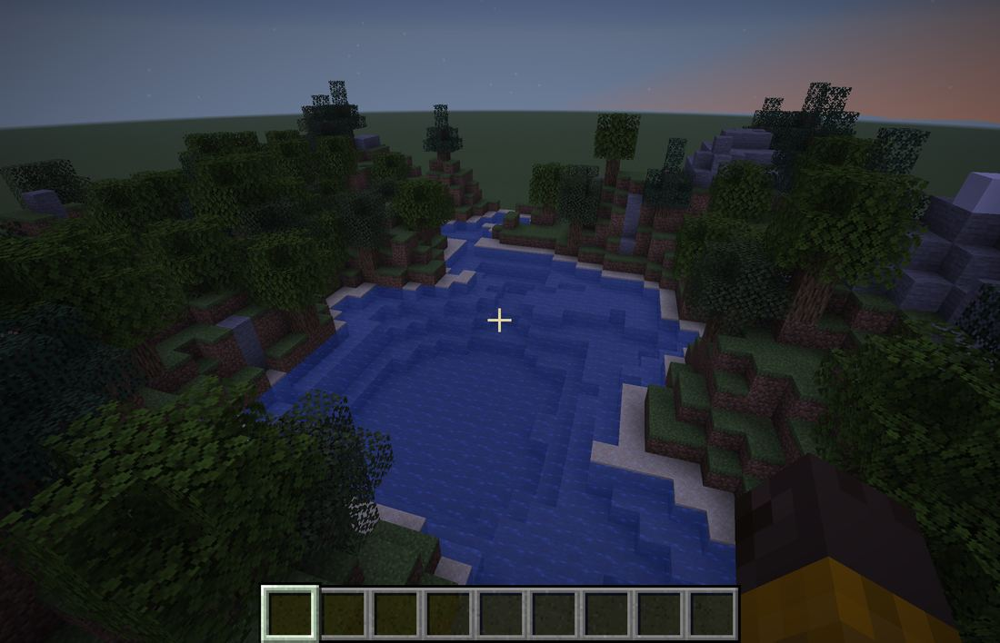

# 1. 風景を置いてみた

[マインクラフトで試してみた](https://fu-yu.github.io/voxel-maker/tried/index.html) の 1 つ目の記録です。
地形は「山と湖」、季節は「夏」を選び、`/function voxel:build` で置きました。

## 上から見る

湖、岸の砂、草の斜面、林、雪ののった石の山が、ボクセル工房の画面と同じ並びで置かれました。
水は湖の形におさまり、木の葉も残りました。

## 横から見る

風景は、地面の上に台のようにのります。地面に立って見ると、まわりが土と石の高い壁になりました。
歩いては登れないので、空を飛んで中に入りました。

## 角から見る

水がふちにある所には、ガラスが立ちます。水は外に流れ出しませんでした。
近くで見ると、ガラスの枠の線が見えます。

## 夕方に見る

夕方や夜は、全体が暗く写ります。色を見比べたいときは、昼にします。
チャットの欄に `/time set day` と打つと、昼になります。

---

- [試してみた一覧へ戻る](https://fu-yu.github.io/voxel-maker/tried/index.html)
- 次: [2. 文字を置いてみた](https://fu-yu.github.io/voxel-maker/tried/text.html)

