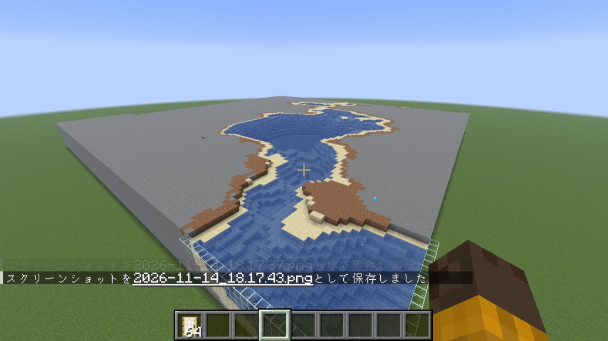
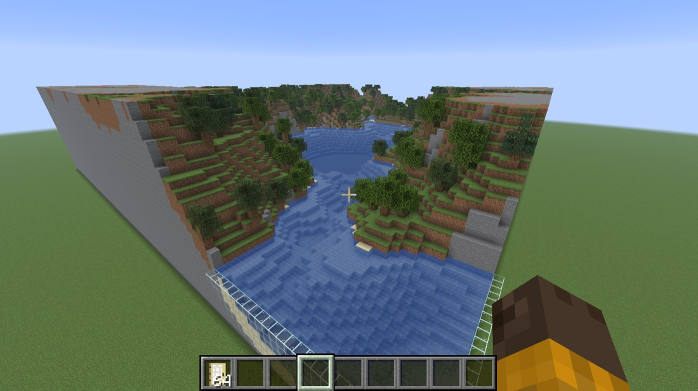
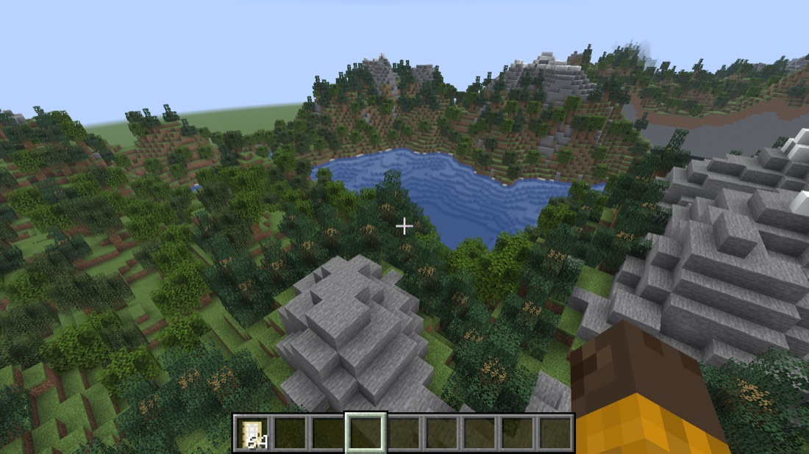
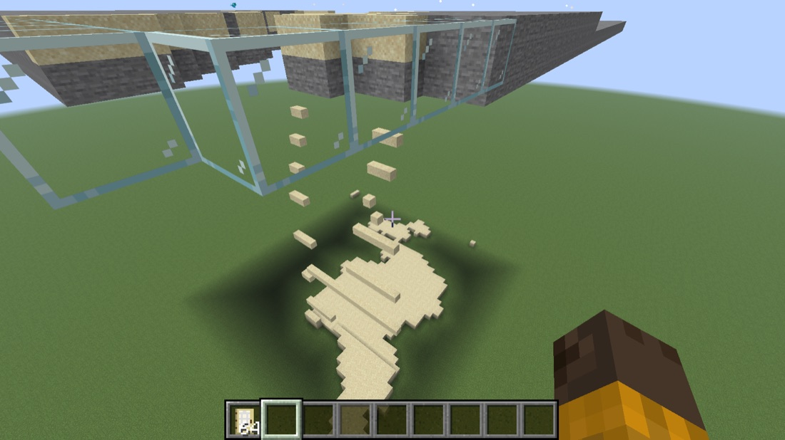
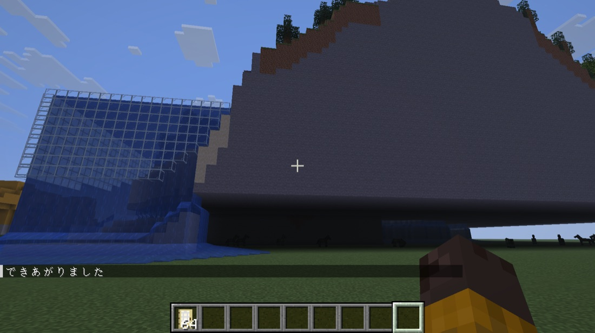
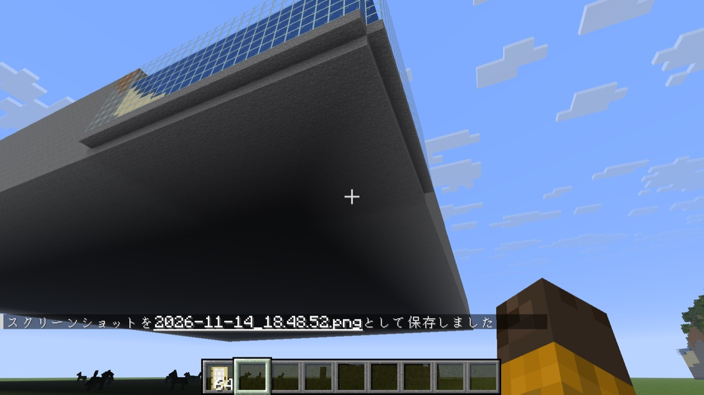

# 3. 少しずつ置いてみた (`voxel:build_slow`)

[マインクラフトで試してみた](https://fu-yu.github.io/voxel-maker/tried/index.html) の 3 つ目の記録です。
いちばん大きい設定の風景 (山と湖・夏、横 128 マス・山の高さ 40 マス、約 32 万ブロック) を、`/function voxel:build_slow` で下の段から少しずつ置きました。

## 建てはじめ

下の段から 1 段ずつ、石・砂・土が広がり、その段の最後に水とまわりのガラスが置かれていきます。右側の茶色い土の上に見える水色の小さな点が、建てる係のアレイです。

## 途中

中腹まで積み上がり、斜面には草と木が並びはじめました。水もガラスの枠の中におさまっています。

## できあがり

2 分ほどで山頂の雪まで積み上がり、「できあがりました」と出ました。最後のアレイがきらきらして消えたかどうかは、広くて追いきれず、画面では確かめられませんでした。

## 空中で始めたときに起きたことと、直したあと

最初に空を飛んだまま `/function voxel:build_slow` を打ったところ、その高さから上に建ちはじめたため、風景が地面から浮きました。1 段目にあった砂が下へ落ちて底に穴があき、ふちのガラスの下にもブロックがなかったため、そこから地面へ水が流れ出しました。

そこで、1 段目の砂をすべて石に変え、ふちのガラスの下端にも石を置くように直しました。

直したあとに、もう一度空中で置いて下から見上げた写真です。底がすべて石でふさがり、ガラスの下端も石で支えられて、砂も水も落ちなくなりました。
また、試している途中で `datapacks` フォルダに古い zip ファイルの名前を変えて残していたところ、古いファイルの中身が読み込まれてしまうこともわかりました。入れ替えるときは、古い zip をフォルダの外に出す必要があります。

---

- 前: [2. 文字を置いてみた](https://fu-yu.github.io/voxel-maker/tried/text.html)
- [試してみた一覧へ戻る](https://fu-yu.github.io/voxel-maker/tried/index.html)

