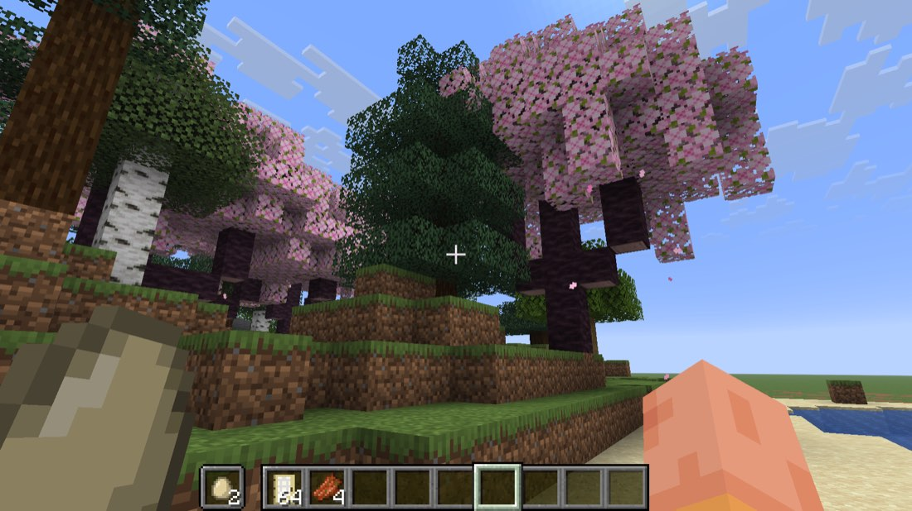
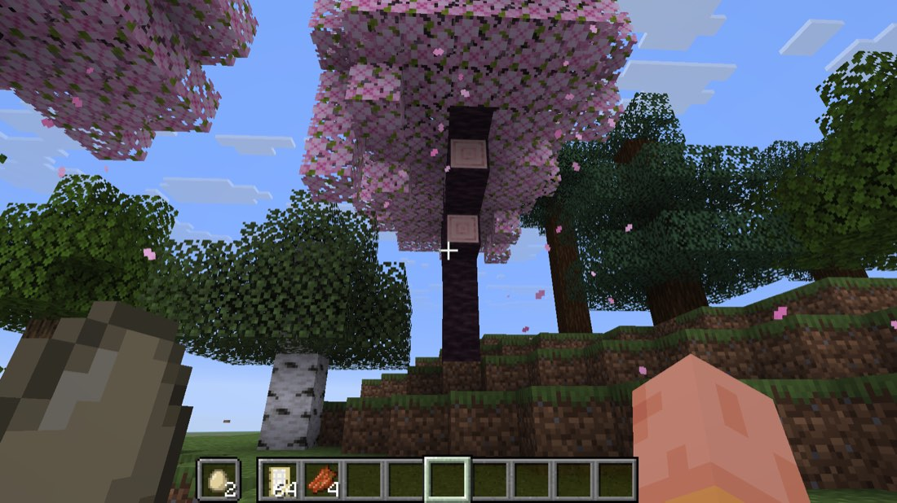
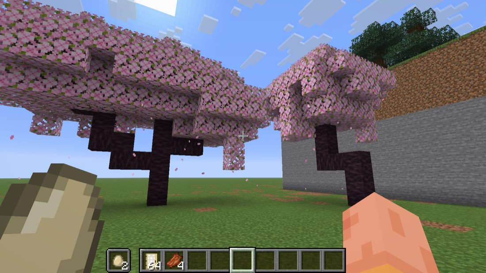
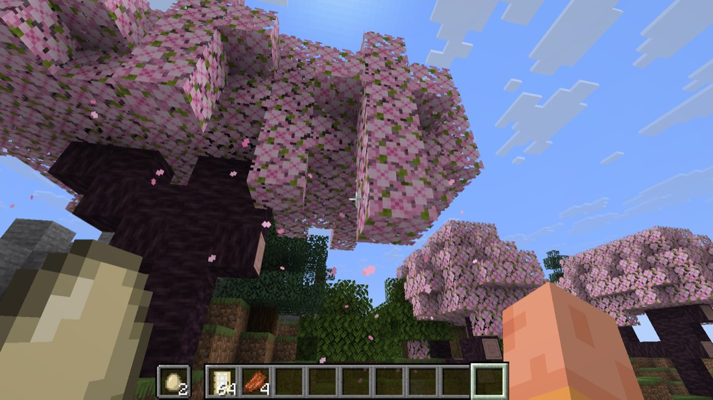

# 6. 春のサクラを置いてみた

[マインクラフトで試してみた](https://fu-yu.github.io/voxel-maker/tried/) の 6 つ目の記録です。
2026-11-17 に、新しく足した季節「春」の風景を、木の形「マインクラフトの木」で置きました。サクラの枝の形を、2 回直しました。

## 最初に置いたとき

春の風景では、丸い木の 3 本に 1 本がサクラになり、残りは明るい緑のオークやシラカバになります。
置いてみると、サクラは平たい傘のような形で、トウヒ・シラカバ・オークとまざって並び、ピンクの花びらの粒も落ちていました。
ただ、横に出た枝の原木も、縦に立てたときの木目のままでした。

## 1 回目の直し (横の枝を横向きの原木に)

横に出る枝を、横向きに置いた原木にしました。切り口の年輪の面が、横を向くようになりました。
ただ、幹が外へ 1 マス進みながら上がる所も横向きにしていたため、まっすぐ立つ幹の途中に、年輪の面が見える所ができました。

## ゲームのサクラを見てみる

ゲームのサクラがどう生えるかを確かめるため、`/place feature minecraft:cherry` で本物のサクラを 2 本生やして見ました。
枝は「横に何マスか (横向きの原木) → 上に何マスか (縦向きの原木) → また横」と、階段のように伸びていました。1 つの原木は、横か上のどちらか一方にだけ進み、ななめにはつながりません。

## 2 回目の直し (階段の形の枝)

枝を 1 マスずつ、「横に 1 マス (横向きの原木)」か「上に 1 マス (縦向きの原木)」のどちらかで伸ばすようにしました。
置き直すと、幹から枝が段になって横に出て、横向きの切り口は、横に進んだ所にだけ出るようになりました。

## 気をつけること

- 地面に花びらのブロック (`pink_petals`) を置くことは、今回はしていません。
- 本物の枝は、もう少しななめに広がって見えます。ボクセル工房の枝は、横と上の段だけで作っています。

---

- 前: [5. 秋の風景を置いてみた](https://fu-yu.github.io/voxel-maker/tried/autumn.html)
- [試してみた一覧へ戻る](https://fu-yu.github.io/voxel-maker/tried/)
- 次: [7. ゲームと同じ形の木を置いてみた](https://fu-yu.github.io/voxel-maker/tried/trees.html)
