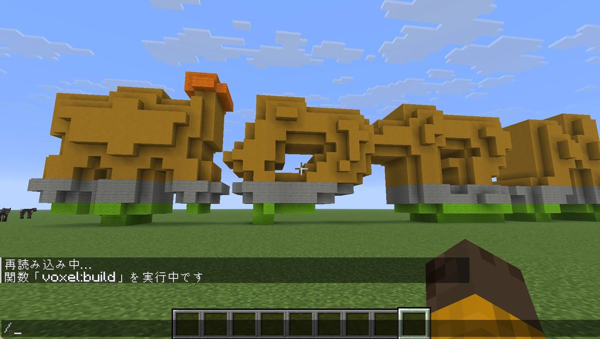

# 2. 文字を置いてみた

[マインクラフトで試してみた](https://fu-yu.github.io/voxel-maker/tried/index.html) の 2 つ目の記録です。
初期設定の「ボクセル」という文字を、`/function voxel:build` で置きました。

## 置いたところ

- 文字は、裏返しにならず、南側から北を向いたときに左から読める向きに置かれました。
- 色に問題がありました。上の橙から下の黄緑へ変わる色づけの途中に、灰色の帯が入りました。
- 同じ日に、近い色のブロックを選ぶ計算を、人の目の感じ方に近い方法 (OKLab) に直しました。直したあとのデータでは灰色が消えていることを確かめましたが、ゲームの画面での写真はまだありません。

---

- 前: [1. 風景を置いてみた](https://fu-yu.github.io/voxel-maker/tried/scene.html)
- [試してみた一覧へ戻る](https://fu-yu.github.io/voxel-maker/tried/index.html)
- 次: [3. 少しずつ置いてみた (`voxel:build_slow`)](https://fu-yu.github.io/voxel-maker/tried/slow.html)

