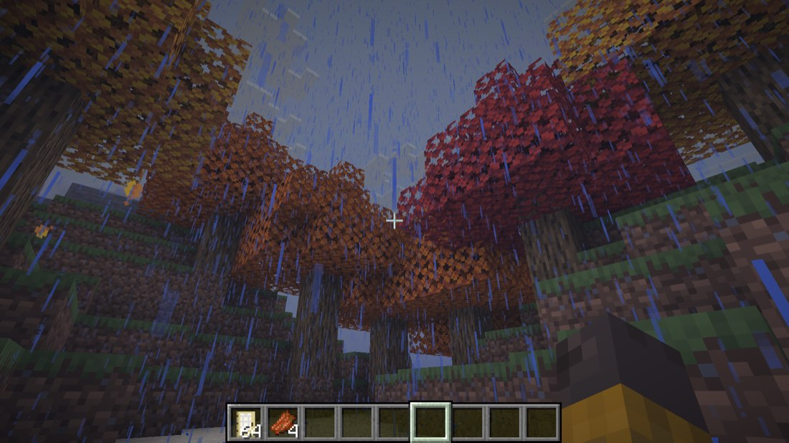
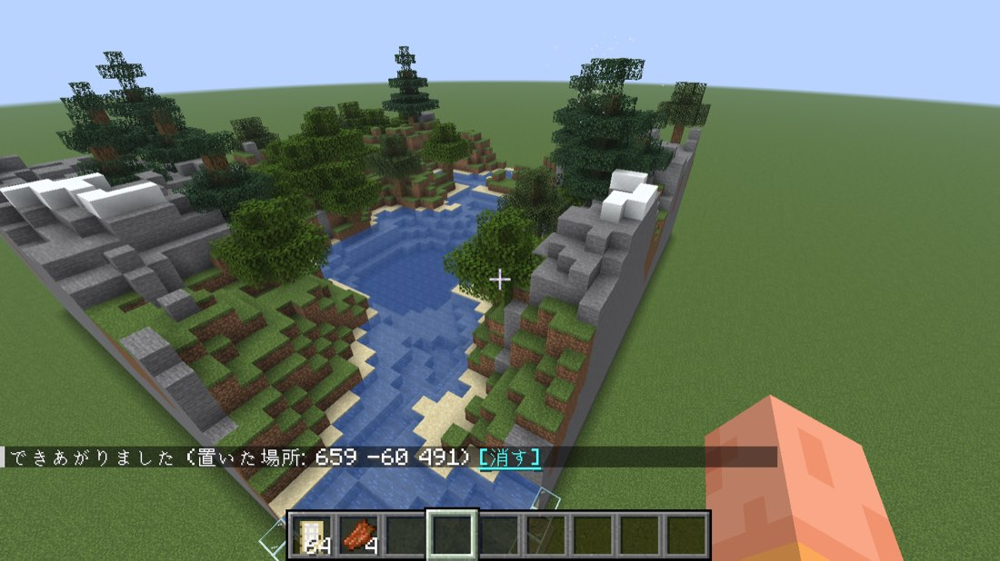
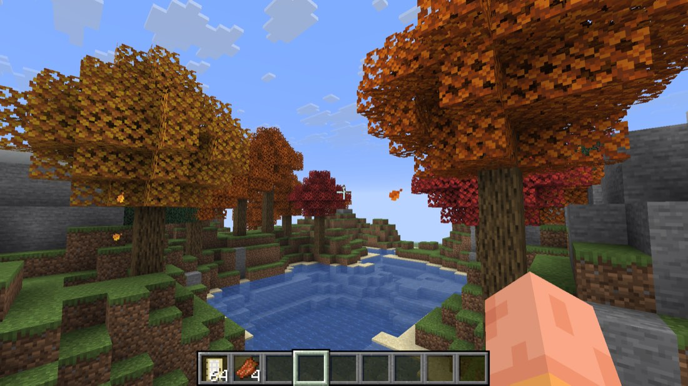
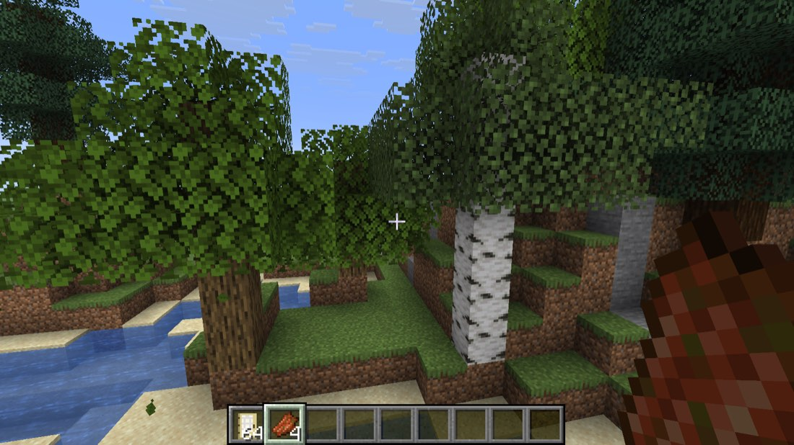

# 7. ゲームと同じ形の木を置いてみた

[マインクラフトで試してみた](https://fu-yu.github.io/voxel-maker/tried/) の 7 つ目の記録です。
2026-11-15〜17 に、風景の木を、マインクラフトの木と同じ形と大きさにして置きました。本体の「木の形」の欄で「マインクラフトの木」を選んだときの木です (はじめに選ばれているのは「小さな緑の木」です)。

## 形の合わせ方

マインクラフトのサーバー版で本物の木を生やし、原木と葉がどこにあるかを 1 マスずつ読みとりました。それと同じ並べ方で、ボクセル工房の木を作っています。

## 丸い木 (オーク・シラカバ)

丸い木は、幹を 4〜6 段 (シラカバは 5〜7 段) にし、その上に葉を 4 段のせました。下の 2 段が 5×5、その上が 3×3、いちばん上が十字です。
雨の中で下から見上げると、高い幹と段になった葉で、ゲームのオークに近い形に見えました。この写真は 2026-11-15 の秋の風景で、このときは秋の木もオークの形でした。

## とがった木 (トウヒ・マツ)

とがった木は、トウヒとマツの形にしました。トウヒは、広い段とせまい段がたがいちがいに重なる円すいです。
前は、とがった木が丸い木より小さく見えていました。直したあとに「建てる係」で置くと、丸い木との高さのつり合いもとれて見えました。マツは数が少なく、見え方はまだよく見ていません。

## 秋のポプラ

秋の丸い木は、ポプラの形にしました。幹は 7〜11 段で、その上半分を、下から広がって上で細くなる丸い葉のかたまりがつつみます。
湖のほとりから見ると、高い幹の上に丸い葉がのり、赤・オレンジ・黄色の葉が落ちる様子も写りました。この写真のときの幹は、まだオークの原木でした。

## 幹の種類

最後に、幹を木の種類ごとに分けました。シラカバはシラカバの原木、トウヒとマツはトウヒの原木、ポプラはポプラの原木です。オークはオークの原木のままです。
森の中から見ると、シラカバの白い幹とオークの幹が並んで見えました。

## 木の大きさ

作るときに「本物と同じ大きさ」を選んだので、木はゲームの木と同じ高さと広さになりました。「小さな緑の木」とくらべると、次のようになります (1 マスはブロック 1 つ分です)。

| 木 | 小さな緑の木 | マインクラフトの木 |
| --- | --- | --- |
| 丸い木 (オーク) | 幹 2〜3 段、葉は 3×3 の玉 | 幹 4〜6 段、葉は 5×5 まで広がる 4 段 |
| シラカバ | (丸い木と同じ) | 幹 5〜7 段 |
| とがった木 | 幹 3〜4 段、小さな円すい | トウヒは幹 6〜8 段、マツは幹 6〜10 段 |
| 秋の丸い木 | (丸い木と同じ) | ポプラの形で、幹 7〜11 段 |
| 1 本が使う広さ | 3×3 マス | 5×5 マス (ポプラとサクラは 7×7 マス) |

「小さな緑の木」は、「マインクラフトの木」の半分くらいの大きさです。マインクラフトの木は、ゲームが自然に生やす木と同じ高さと広さなので、ワールドにもともとある木と並べても、大きさがそろいます。

## 木の形を 2 つにした理由

木をマインクラフトの木に近づけていくうちに、ボクセル工房の画面で見たときの木が、前の小さな緑の木の感じから変わってしまったことに気づきました。
前の木は前の木で好きだったので、どちらも残すことにしました。本体の「木の形」の欄で、「小さな緑の木」と「マインクラフトの木」を選べます。

## 気をつけること

- 「マインクラフトの木」は、「小さな緑の木」より大きいので、同じマス数だと風景がせまく感じることがあります。せまく感じたら、横のマス数を自分で大きくしてください。
- 「木の形」を切りかえても、マス数や山の高さは変わりません (使う人が決めた数を、ほかの項目で勝手に変えないようにしています)。

---

- 前: [6. 春のサクラを置いてみた](https://fu-yu.github.io/voxel-maker/tried/spring.html)
- [試してみた一覧へ戻る](https://fu-yu.github.io/voxel-maker/tried/)
