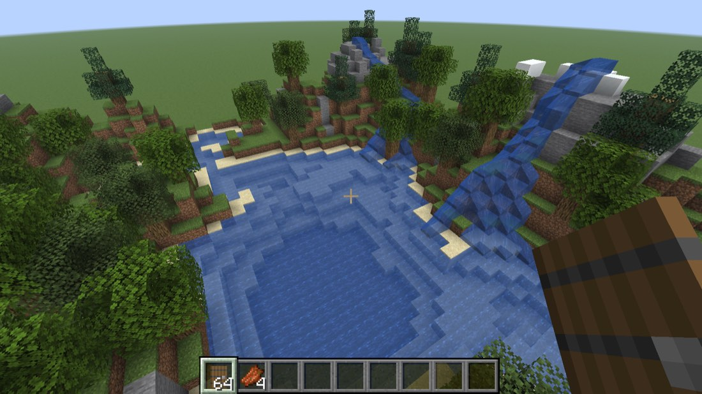
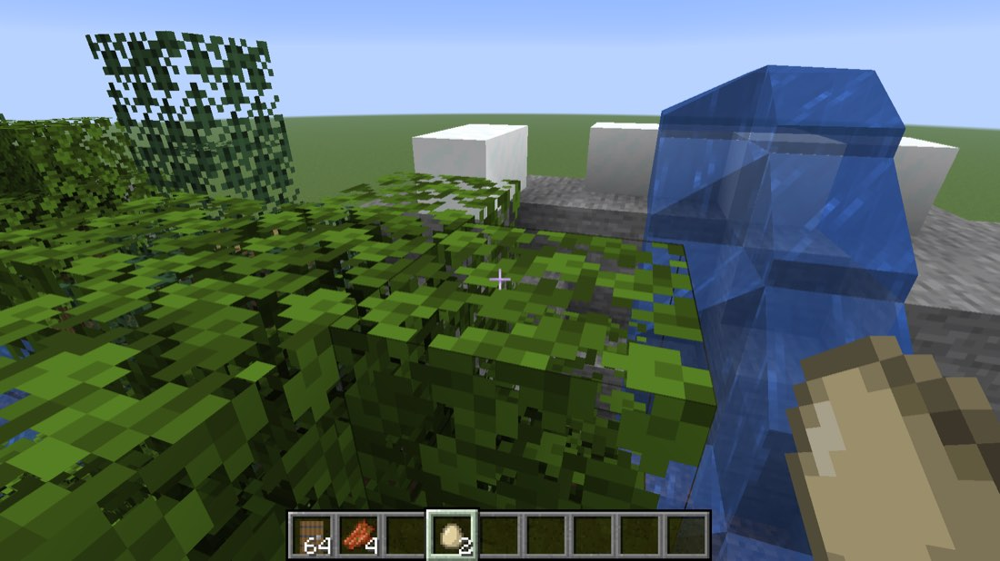
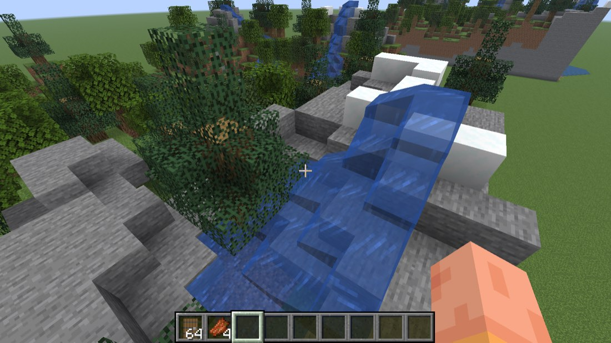
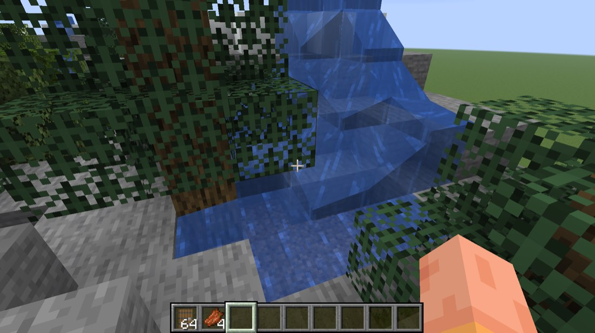
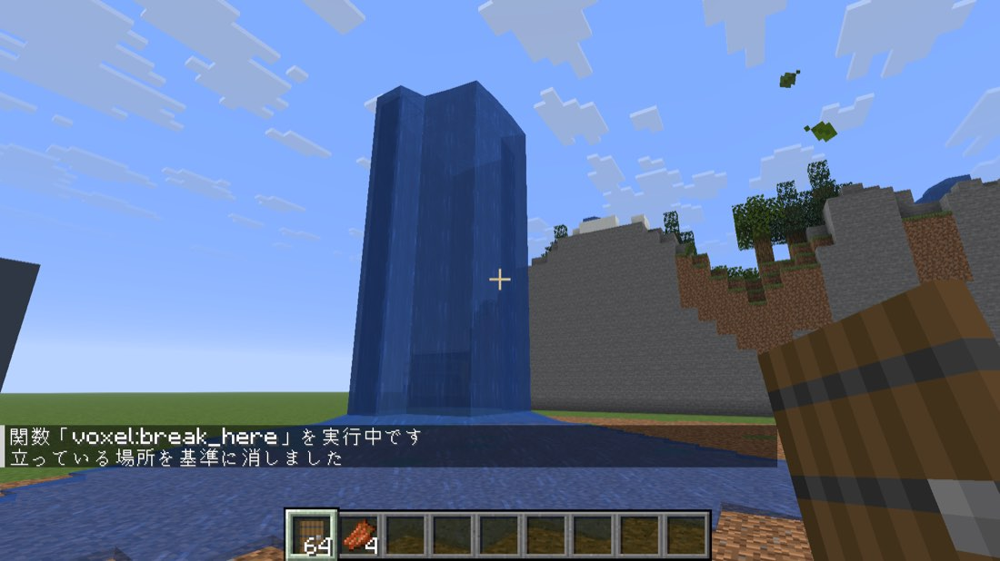

# 8. 山の上から水を流してみた

[マインクラフトで試してみた](https://fu-yu.github.io/voxel-maker/tried/) の8つ目の記録です。
2026-11-20〜21に、風景を保存するときの設定「山の上から水を流す」を試しました。高い山のてっぺんに水を置き、ゲームの中で流れていく様子を見ました。

## 水を置く場所の決め方

ボクセル工房の本体で「山の上から水を流す」をオンにして保存すると、高い山のいくつか (最大3か所) のてっぺんに水が置かれます。
水を置く前に、マインクラフトと同じ決まりで、水がどこまで流れるかを計算しています。流れた水が風景の外にこぼれる山には、水を置きません。冬の風景には置きません (湖が氷になっているため)。

## 滝になって湖へ

「山と湖・夏」の風景 (番号12) を、水を3か所にして置きました。2か所の水は、斜面を段になって流れ落ちる滝になり、湖まで届きました。
風景の外に、水はこぼれませんでした。

## 湖に届かなかった1本

3か所のうち北の尾根の1か所は、斜面の途中のくぼみで止まり、湖まで届きませんでした。計算でも同じ所で止まっていました。
「もっと湖のようにたまるとよい」と考えて、流れた先がくぼみのときは、ふちの高さまで水を満たして、小さな池にするように直しました。

## くぼみが池になった

直したあとに置き直すと、北の尾根の水は、雪の下から岩の斜面を下り、ふもとで止まりました。まわりの草地には、こぼれていません。

ふもとの石のくぼみには、平らな水面の池ができました。池の水は、ふちからあふれていません。

## 消したときの水

はじめは、「できあがりました」の [消す] で風景を消すと、流れた水が空中に柱のように残り、地面に落ちてから、数秒かけてゆっくり消えました。消すときに、置いたブロックだけを消していて、あとから流れた水は消す対象に入っていなかったためです。
そこで、一気に消す `/function voxel:break` と [消す] では、先に風景の範囲の水をすべて消すように直しました。直したあとは、流れた水もいっしょにすぐ消えることを、ゲームの画面でも確かめました。

## 画面でも見られるように

このあと、ボクセル工房の画面の立体にも、流れ終わったあとの水 (滝や池) を表示するようにしました。水が流れていく途中の動きは出ません。

## 気をつけること

- 水が流れた所の下の草は、時間がたつと土に変わります。マインクラフトのしくみです。
- 峰がすべて風景の端の近くにあると、水が1か所も置かれないことがあります。そのときは、保存したときのお知らせに出ます。

---

- 前: [7. ゲームと同じ形の木を置いてみた](https://fu-yu.github.io/voxel-maker/tried/trees.html)
- [試してみた一覧へ戻る](https://fu-yu.github.io/voxel-maker/tried/)
